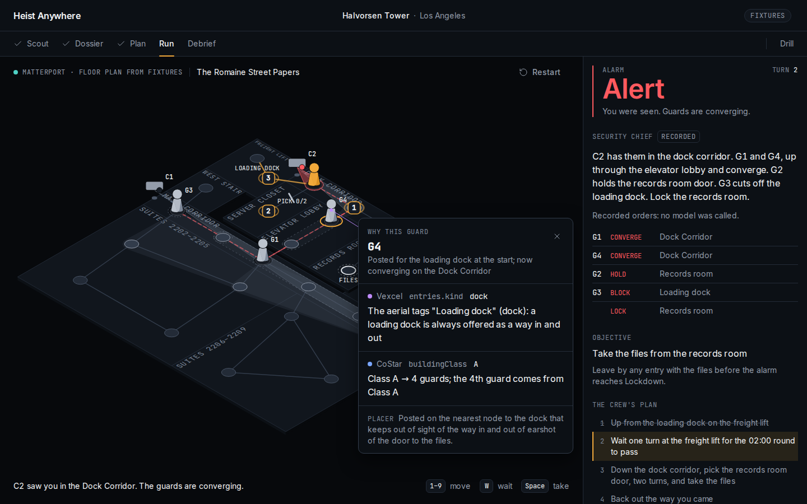
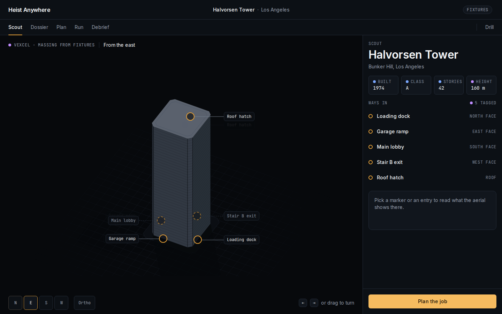
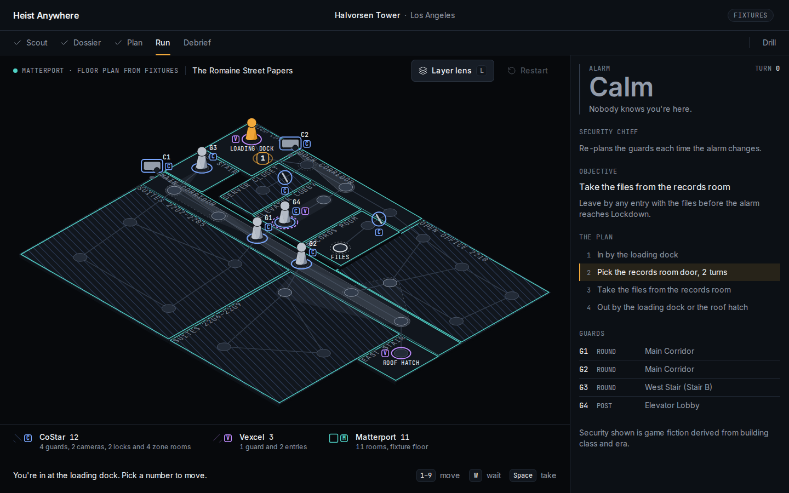
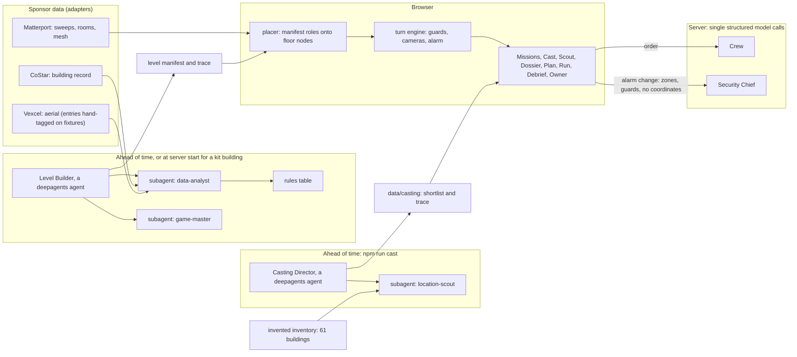

# Hobbs

**A stealth game whose levels an AI agent builds from a building's data.
CoStar's record sets the security era, the guard force and the quiet zones,
Vexcel's aerial shows the building from above, and Matterport's scan is the
floor you play on, in first person. Trip a camera and an AI Security Chief re-plans the
guards in front of you and says why. Click any guard to see which data put it
there. Then Owner Mode lets a building's security lead put in their own
security and watch an AI crew try 50 ways in.**

Built at HackPrinceton Fall 2026. Main track: Entertainment. Special tracks:
CoStar "AI for the Built World", LangChain "Best use of deepagents", Amazon
"Best Practical AI Innovation". For the Amazon track: the Security Chief
re-plans the guards on every alarm change and says why
([`replanChief`](src/agents/chief/chief.ts)), and the engine clamps its orders
to legal moves ([`applyChiefOrders`](src/engine/orders.ts)). It also adapts
between runs: the browser keeps a summary of your earlier runs, posts a guard
by the way in you used most ([`postureOf`](src/components/run/run-history.ts),
deterministic), and the Chief is given that summary and opens its rationale
by saying so ([`tests/smoke/adapt.spec.ts`](tests/smoke/adapt.spec.ts)).
Amazon Bedrock is wired in as an alternative model provider
([`bedrock.ts`](src/adapters/llm/bedrock.ts)) and not used.

*Screenshots from 14 November, before the case-file restyle and first person; the Run now opens in first person on desktop.*



> **What runs live, and what is recorded.**
>
> - **Fake mode** is the default, and it is what CI, the gate and every
>   screenshot here use. Every service answers from files: five invented
>   fixture buildings, an invented 61-building inventory, hand-authored
>   floors, Vexcel massings drawn from footprint and height, and recorded or
>   scripted model turns. No keys.
> - **Live mode** (`HEIST_MODE=live`, with keys) takes each service off its
>   fixtures on its own. CoStar comes from the CoStar data kit, read from
>   disk on the server and never committed. Vexcel serves real aerial photos.
>   Matterport's scan becomes the floor, and first person walks inside it.
>   Claude answers the Level Builder, the Crew and the Security Chief.
> - **Casting stays on the invented inventory in every mode.** The Cast
>   screen replays a cached Casting Director run over it; nothing searches
>   the real kit for a building (below).
>
> The top bar's mode chip says which services are on fixtures, on every
> screen. [What runs on what](#sponsor-technology-and-where-it-lives).

## What you play

The app opens on the **mission picker**: five missions
([`fixtures/missions.json`](fixtures/missions.json)), each inspired by a
documented, non-violent piece of corporate history or labelled fiction. Pick
one and follow the primary button through **Cast → Scout → Dossier → Plan →
Run → Debrief**.

In fake mode the first mission, *The Romaine Street Papers*, is inspired by
the 1974 Summa Corporation burglary on Romaine Street. **Cast** replays the
Casting Director narrowing the inventory to three finalists, filter by
filter, with the map's pins dimming as each applies; the first is Halvorsen
Tower, an invented building. **Scout** shows its aerial with the tagged ways
in. **Dossier** replays the Level Builder's run and fills in the Data → Level
table: **1974** means key locks and analog cameras that sweep, **Class A**
means four guards on tight rounds, **floor 22** is mostly on the market so
its suites are dark and quiet, and the **loading dock** on the aerial is your
way in.

On **Plan** you brief your crew in plain English ("Go in through the dock,
wait for the 2 am round to pass, take the records room") and they push back:
camera C2 covers the dock corridor. On **Run**, walk into its view anyway and
the alarm jumps to Alert, the guards converge, and the Security Chief
re-plans, saying why. Click a guard and the Why card shows the field behind
it. Press `L` for the **Layer lens**, which tints every piece and room by the
data layer that produced it. The **Debrief** grades the run, replays your
path and every guard's, and lists the Chief's decisions with their reasons.

Three fixture buildings have a floor and a built level: F1, F2 and F3
([`fixtures/floors/`](fixtures/floors/), [`data/levels/`](data/levels/)). F4
and F5 have facts and an aerial, and their Plan and Run screens say the level
isn't ready yet.

## A real building

In live mode, a real building from the CoStar kit reaches the game only by a
person's choice, never an agent's: the team's `SHOWCASE_LEVELS` list on the
server, pairs of kit building id and mission
([`showcase.ts`](src/lib/showcase.ts)), or, with that list empty, any kit
building in a mapped city, opened from `/map`
([`map/page.tsx`](src/app/map/page.tsx)), whose level is built on demand.
The live CoStar adapter's inventory search still answers from the fixture
inventory, because the kit mapping does not yet give a property type or
entry kinds ([`live.ts`](src/adapters/costar/live.ts)), and
[`/api/cast`](src/app/api/cast/[missionId]/route.ts) serves a cached
Casting Director shortlist, cast over that inventory, in every mode. The
committed shortlists were cast on recorded model turns.

For a mission on that list:

- **Cast** shows the paired building beside the replay, with each of the
  mission's needs set against its CoStar record: met, missed, or not on the
  record ([`showcase-cast.ts`](src/lib/showcase-cast.ts)).
- **The Level Builder builds its level when the server starts**, one level
  at a time, in memory, on Claude
  ([`warm-showcase.ts`](src/agents/builder/warm-showcase.ts)). If that build
  failed or has not run, the Dossier's **Build this level** runs it
  ([`build-level-button.tsx`](src/components/dossier/build-level-button.tsx);
  about 2.5 minutes of model calls).
- **Scout** shows Vexcel's live photos. A kit building has no hand-drawn
  massing, so the view is aimed from a square derived from its CoStar floor
  area and height, and no ways in are tagged on it; its level offers the
  roof hatch and the street lobby, and the Why card says nothing in CoStar's
  facts marks a way in.
- **Run** builds the board from the building's Matterport scan, in the tab's
  memory, and plays it in first person inside the scan.

## First person

The Run screen has three ways to look: first person, the default on a
desktop browser, with a switch back to the board (a phone-width screen gets
the board); on the board, a Tactical / Live switch, where Tactical waits for
you and Live passes a turn you let run out
([`live-controls.tsx`](src/components/run/live-controls.tsx)); and on a live
scan, the board beside the scan, with a Split / Board / Scan switch
([`run-stage.tsx`](src/components/run/run-stage.tsx)).

- **On the fixture floors** (F1, F2 and F3), our own three.js renderer draws
  the hand-authored floor
  ([`first-person-view.tsx`](src/components/run/fp/first-person-view.tsx)).
- **Inside a real scan**, the scan's mesh and panoramas are drawn by the same
  view, with guards, cameras, doors and markers placed in the scan. The board
  and the mesh are checked against each other on every load, and any
  mismatch, failed load or missing key gives the board back with a line
  saying why.
- **Real time.** The clock waits for your first move ("Look around. The
  clock starts when you move."). Once you first move, a turn passes every
  700 ms whether or not you move again
  ([`FP_TURN_MS`](src/components/run/fp/tuning.ts)); guards and camera sweeps
  keep going. `P` pauses. The engine still decides everything: walking into
  another node's area plays that move.
- **Controls.** W A S D and the mouse. **Hold E** at a locked door to pick
  it, a turn at a time, and at the objective to take it.
- **Readable danger.** One suspicion meter says who has you in view, who
  heard you, and when you are one step from a camera's sight. Cameras show a
  light cone on the floor they watch this turn and an outline where they look
  next, labelled "Camera C1".
- **Feedback.** Once you have the files, a "Carrying the files" chip shows
  and the goal names every way out; exits read `WAY OUT`. A door that opens
  says so. A run ends on a card that says why, with the way to the Debrief.

**Inside the real building, expect to be caught.** Nobody on the team has
won that run yet, and a capture, which the Debrief replays, is the
expected ending. For a winnable first-person run, play fixture F1.

## Owner Mode

**Break into any building for fun. Or put in your real security and watch an
AI crew try 50 ways in.** From the Debrief, **Owner Mode** opens the same
floor as a setup editor: move guards and draw their rounds, place cameras,
add night cleaners, set each door to key, badge or open, and mark staffed
desks. The editor starts from the level's own security, so it is never
empty, and names any broken round before it lets you run.

- **Run 50 attempts.** The crew writes five strategies once (an AI call in
  live mode, recorded in fake mode), and the engine plays each over ten seeds
  in the browser, with no model call per move
  ([`BATCH_SEEDS`](src/engine/autoplay.ts),
  [`fixtures/llm/strategies-F1.json`](fixtures/llm/strategies-F1.json)). On
  F1 in fake mode, 17 of 50 get out, 14 of them by the same way out. The
  guard or camera that spotted the crew first most often is ringed on the
  board.
- **Coverage and open windows.** Beside the count: how much of the floor is
  watched, and how many moments let a crew in and out unseen by guards and
  cameras. On F1, 47% and 40 of 80.
- **Ask the Chief for a fix.** It suggests one change ("C2 now covers the
  dock corridor"), and **Apply and rerun** puts before and after side by
  side: 17 of 50 to 0 of 50, coverage 47% to 50%, open windows 40 of 80 to
  0 of 80.
- **Compare two setups.** Any two saved or prepared setups, side by side. The
  prepared pair, a made-up night shift with and without C2 moved into the
  dock corridor, goes from 7 of 50 to 1 of 50.

The F1 results above are asserted by
[`tests/smoke/owner.spec.ts`](tests/smoke/owner.spec.ts). Owner Mode runs on
fixture buildings only, with "Made-up setup on a fixture building. Real
setups stay on this device." always on screen
([`owner-screen.tsx`](src/components/owner/owner-screen.tsx)).

**Who it is for.**

- **The player**: someone who wants a story-driven heist set in a real kind
  of building, in a browser tab, in ten minutes.
- **The building's security lead**: Owner Mode does the first pass of a
  physical security review, the "how would someone get to the records room?"
  walk that today takes a consultant and a site visit. The weak spot the crew
  keeps using is the one to fix first, and the Chief's suggested change can
  be checked by rerunning before anyone moves a camera. It is a first pass,
  not a security assessment, and it doesn't replace one.

**Drill Mode is on hold** (`hackathon/SPEC.md` §1, Q8): its code and its
route stay, and the step rail still shows it, but it is off the demo.

**Taste rules we hold to.** No tenant data: the CoStar adapter reads only the
kit's property and listing files and its scan index, never its tenant files
([`KIT_FILES`](src/adapters/costar/mapping.ts), and a test that proves it).
No kit record is committed; tests use a fictional kit
([`test-kit.ts`](src/adapters/costar/test-kit.ts)). Missions are drawn from
documented, non-violent corporate history, or are fiction and say so. The
security on the board is game fiction derived from class and era, never a
claim about a real building. Owner Mode is the one exception, and it is the
owner's own: the public game only ever shows the generated security, an
owner's setup stays in that browser's storage
([`owner-setup-store`](src/components/run/owner-setup-store.ts)), and no
node, coordinate or route of the floor reaches a model: the crew's strategies
are asked for by building id
([`/api/crew/strategies`](src/app/api/crew/strategies/route.ts)), and the
Chief's fix gets the building id and a summary of counts, zone ids and
element ids ([`/api/chief/fix`](src/app/api/chief/fix/route.ts)). A shipped
version would unlock Owner Mode only for verified owners of the building,
which CoStar's ownership records already make possible.

*Screenshots from 14 November, before the case-file restyle and first person; the Run now opens in first person on desktop.*

| | |
|---|---|
|  |  |
| **Dossier.** The Level Builder's run replays as a checklist of todos, subagent tasks and tool calls, and the Data → Level table fills in. | **Scout, fake mode.** The fixture massing, drawn from footprint and height, with its tagged ways in. Live mode shows Vexcel's photos instead. |
|  |  |
| **Layer lens.** Every element tinted and lettered C, V or M by its source, with a legend counting each layer. | **Owner Mode.** 50 attempts against the setup: the count, each strategy, and the way out the crew used most. |
|  | |
| **Before and after.** The Chief's one change, rerun: 17 of 50 to 0 of 50. | |

## How it works

One Next.js app. The game engine, the board and first person run in the
browser. Server route handlers hold the keys, read the CoStar kit, and talk
to Vexcel, Matterport's Model API and the model.



There are two `deepagents` agents, and both run ahead of play: the Casting
Director per mission, the Level Builder per building and mission. The Crew
and the Security Chief are not agents in that sense: each is a single
structured model call with a 4 s timeout and a recorded or rule-based
fallback ([`structured.ts`](src/adapters/llm/structured.ts)). Owner Mode's
strategies and the Chief's fix are single structured calls too.

1. **The rules table decides the numbers.**
   [`deriveSecurityProfile`](src/level/rules.ts) maps fields to level
   parameters deterministically (year built to security era, class to guard
   count, available space to the staged floor and its quiet and crowded
   zones, aerial tags to entries), and every output carries a provenance entry
   naming its layer, field, value and rule. The agent calls it as a tool
   instead of inventing difficulty. Every Why card reads those entries
   ([`src/components/run/why.ts`](src/components/run/why.ts)), and so does
   the **Layer lens** on the Run and Plan boards
   ([`lensElements`](src/components/run/lens.ts),
   [`layer-lens.tsx`](src/components/run/layer-lens.tsx),
   [`tests/smoke/lens.spec.ts`](tests/smoke/lens.spec.ts)): each guard,
   camera, lock, zone and entry takes its layers from that provenance, and
   the room tiles are Matterport, from the floor graph's `source`.
2. **The agents run ahead.** The Casting Director writes a shortlist and
   trace per mission to [`data/casting/`](data/casting/); the Level Builder
   writes a manifest and trace per fixture building and mission to
   [`data/levels/`](data/levels/). A kit building's level is built live and
   kept in server memory, never written to disk. The Cast screen and the
   Dossier replay the traces, so no screen waits on an agent.
3. **The engine is authoritative.** [`src/engine/`](src/engine/index.ts) is
   pure, seeded TypeScript. Model output (crew plans, Chief orders) is parsed
   against a zod schema and clamped to legal moves
   ([`applyChiefOrders`](src/engine/orders.ts),
   [`validatePlan`](src/level/validate-plan.ts)), and guards move on the
   engine's own decision before any model answers. First person and the
   board both hand every action to the same engine.
4. **The floor graph is built in the browser, and only these fields leave
   it.** The floor graph, from a fixture or from Matterport, is built in the
   page. Its coordinates, sightlines, adjacency and room shapes are never
   sent, and neither is the graph as a whole. A scan's board and mesh are
   held in the tab's memory only, and a kit building's run log is never
   stored. The routes that take a body from the game:
   - [`/api/crew`](src/app/api/crew/route.ts) reads only the building id,
     the order the player typed and the mission id
     ([`crew-request.ts`](src/components/plan/crew-request.ts)). The server
     reads the zones, the guard roster and the security profile from its own
     cached manifest ([`crewContext`](src/agents/crew/prompt.ts)). No
     camera's position goes with them.
   - [`/api/chief`](src/app/api/chief/route.ts) takes a
     [`ChiefRequest`](src/agents/chief/request.ts) and refuses any field
     outside it: the building and mission ids; the alarm transition (turn,
     from and to, and its cause, with a camera, guard or cleaner id such as
     `C2`); the last-known zone; each guard's id, zone and intent; the zones
     the Chief may name, as id and name; and, on the run's first alarm, the
     summary of earlier runs in those zone ids. The zones are the manifest's
     zones and entries, with their game-fiction names, then the floor's other
     rooms ([`chiefZones`](src/components/run/chief-request.ts)). On a
     fixture floor those rooms go by their room id and label. **On a scanned
     floor each goes as an opaque `area-N` id with the scan's room name**:
     letters, digits and simple punctuation only, at most 80 characters,
     `Area N` when it has none. So on a scanned floor the Chief learns the
     scan's room names, how many there are, and which named area each guard
     and the last sighting is in. It never gets a scan id, a node, a
     coordinate or the layout. The prompt adds the mission and security
     profile from the server's manifest.
   - [`/api/crew/strategies`](src/app/api/crew/strategies/route.ts) and
     [`/api/chief/fix`](src/app/api/chief/fix/route.ts), Owner Mode's, are
     above under the taste rules.
5. **A scan's mesh never passes through the server.**
   [`/api/scan-mesh`](src/app/api/scan-mesh/route.ts) takes the model id in a
   POST body, asks Matterport's Model API, and relays short-lived signed
   links; the browser fetches the mesh and panoramas itself, into memory.
   The server caches and writes nothing.

## Sponsor technology, and where it lives

Every external service sits behind an adapter whose `index.ts` picks live or
fake from the environment and exports one interface. **Fake** means it answers
from files in [`fixtures/`](fixtures/). **Live** means it calls the service
(or, for CoStar, reads the kit), and it is chosen only when the mode is
`live` and the keys are set. When a live CoStar, Vexcel or Matterport call
fails, the fake takes over and the app flags it. A model call that fails or
times out is answered by a recording, or for the Chief by its template.

| technology | what it does in the product | code | fake | live |
|---|---|---|---|---|
| **CoStar** building data | Year built, class, stories, floor area and available suites become the security era, guard force, staged floor, and quiet and crowded zones; a showcase building's record is set against its mission's needs on the Cast screen | [`src/adapters/costar/`](src/adapters/costar/index.ts): `getCoStar`; [`live.ts`](src/adapters/costar/live.ts) `createLiveCoStar`; the kit reader [`kit.ts`](src/adapters/costar/kit.ts) `loadKitIndex`; [`mapping.ts`](src/adapters/costar/mapping.ts) `KIT_FILES`. Read by [`src/level/rules.ts`](src/level/rules.ts) | Five invented buildings ([`fixtures/costar/buildings.json`](fixtures/costar/buildings.json)) and an invented 61-building inventory for casting ([`fixtures/inventory.json`](fixtures/inventory.json)) | `COSTAR_KIT_DIR`, the unpacked kit, never committed. Kit buildings show on the map (only the `SHOWCASE_LEVELS` ones when that is set) and get levels built live. The inventory search still answers from the fixtures |
| **Vexcel** aerial imagery | The Scout screen's views from above; on a fixture building, the entry tags placed on its massing become the level's ways in and out | [`src/adapters/vexcel/`](src/adapters/vexcel/index.ts): `getVexcel`; [`live.ts`](src/adapters/vexcel/live.ts) `createLiveVexcel`; [`derived-massing.ts`](src/adapters/vexcel/derived-massing.ts). Served by [`/api/buildings/[id]/aerial`](src/app/api/buildings/[id]/aerial/route.ts) | A massing drawn as SVG from each building's footprint and height, in five views (N, E, S, W, ortho), with hand-placed entry tags, [`fixtures/vexcel/`](fixtures/vexcel/) | `VEXCEL_API_BASE` and `VEXCEL_API_KEY`. Real ortho and oblique photos, proxied through the server and held in memory, never stored. A fixture building's hand-placed tags are pinned on the photo; a kit building is aimed from a square derived from its CoStar facts and has no tags. Entries are not detected from the imagery |
| **Matterport** 3D scans | The floor: nodes, edges, doors and sightlines; and the scan you walk in first person | [`src/adapters/matterport/`](src/adapters/matterport/index.ts) (browser only): `getMatterport`; [`mapping.ts`](src/adapters/matterport/mapping.ts) `toFloorGraph` from Showcase SDK `Sweep.data` and `Room.data`; first person in the scan, [`src/components/run/fp/`](src/components/run/fp/first-person-view.tsx); [`/api/scan-mesh`](src/app/api/scan-mesh/route.ts) | Hand-authored floors for F1, F2 and F3, [`fixtures/floors/`](fixtures/floors/). They are fiction: no Matterport content is in the repo | `NEXT_PUBLIC_MATTERPORT_SDK_KEY` (domain-bound) for the floor graph; `MATTERPORT_API_KEY` and `MATTERPORT_API_TOKEN` (server only) for the mesh and panoramas. Everything from a scan stays in the tab's memory |
| **LangChain `deepagents`** | Two deep agents. The **Casting Director**: `createDeepAgent` with a todo list, the subagent `location-scout` (tools `get_mission`, `search_inventory`, `get_candidate`, `get_aerial_entries`) and its own `get_mission` and `write_shortlist`. The **Level Builder**: a todo list, the subagents `data-analyst` (`get_building`, `get_available_space`, `get_aerial_entries`, `derive_security_profile`) and `game-master` (`get_mission`), and its own `write_manifest`. deepagents' `general-purpose` subagent is passed explicitly to each, so it shows in the traces | [`src/agents/casting/`](src/agents/casting/director.ts) `castMission`, run by [`scripts/cast.mts`](scripts/cast.mts); [`src/agents/builder/`](src/agents/builder/builder.ts) `buildLevel`, run by [`scripts/build-levels.mts`](scripts/build-levels.mts), [`warm-showcase.ts`](src/agents/builder/warm-showcase.ts) and [`/api/levels/[id]/generate`](src/app/api/levels/[id]/generate/route.ts) | The real deep agents run, graph, todos, subagent dispatch and tools included, against the fake adapters. Only the model's turns are replayed, by [`ScriptedChatModel`](src/adapters/llm/scripted.ts), from [`fixtures/llm/scripts/`](fixtures/llm/scripts/). The committed shortlists and the F1, F2 and F3 levels come from these runs | The same agents on Claude through `@langchain/anthropic`. In the app, live runs are the Level Builder's, for kit buildings: at server start for the showcase, or from the Dossier. A live run of the Casting Director (`npm run cast` in live mode) still searches the fixture inventory. An early live Level Builder run on F1 is kept in [`fixtures/llm/recorded/pre-119/`](fixtures/llm/recorded/pre-119/); it predates the mission input and no longer replays |
| **Anthropic Claude** | The model for both deep agents, and one structured call each for the Crew, the Security Chief, Owner Mode's strategies and the Chief's fix | [`src/adapters/llm/`](src/adapters/llm/index.ts): `selectChatModel` in [`select.ts`](src/adapters/llm/select.ts), `createAnthropicModel` in [`anthropic.ts`](src/adapters/llm/anthropic.ts), `structuredCall` in [`structured.ts`](src/adapters/llm/structured.ts). Agents: [`crew`](src/agents/crew/crew.ts) `briefCrew`, [`chief`](src/agents/chief/chief.ts) `replanChief` | Recorded replies: keyword-routed for the Crew ([`fixtures/llm/crew-F1.json`](fixtures/llm/crew-F1.json)), per alarm transition then a deterministic [template](src/agents/chief/template.ts) for the Chief ([`chief-F1.json`](fixtures/llm/chief-F1.json)). The UI labels each answer recorded or rule-based | `ANTHROPIC_API_KEY`; default model `claude-sonnet-4-6`; on a 4 s timeout or a bad answer the recording answers instead. Measured: the Chief answers in about 3 s. #163 measured the Crew at 3.7 and 4.1 s against its 4 s timeout, so on a slow network it can fall back to the recording |
| **Amazon Bedrock** | An alternative model provider | [`src/adapters/llm/bedrock.ts`](src/adapters/llm/bedrock.ts) `createBedrockModel` (`ChatBedrockConverse` from `@langchain/aws`) | — | Wired in and not used: `LLM_PROVIDER=bedrock`, refused unless `BEDROCK_ENABLED=1` |

## Run it

You need Node 22.12 or later. No keys, no `.env.local`, no database.

```sh
git clone https://github.com/Ollienel777/Insider.git
cd Insider
npm ci
npm run dev
```

Open <http://localhost:3000>. With no `.env.local` every service is on
fixtures, and the top bar's chip reads `FIXTURES`. Pick a mission and follow
the primary button on each screen: Cast, Scout, Dossier, Plan, Run, Debrief.
*The Romaine Street Papers*, *Hole in the Ground* and *The Night Desk* cast
onto F1, F2 and F3, which have levels. Set `PORT` to use another port.

**Live mode**, once you have keys: copy [`.env.example`](.env.example) to
`.env.local`, set `HEIST_MODE=live`, and fill in what you have:
`ANTHROPIC_API_KEY`; `COSTAR_KIT_DIR`; `VEXCEL_API_BASE` and
`VEXCEL_API_KEY`; `NEXT_PUBLIC_MATTERPORT_SDK_KEY`, `MATTERPORT_API_KEY` and
`MATTERPORT_API_TOKEN`. Each service goes live on its own; the rest stay on
fixtures. With CoStar live, every kit building in a mapped city shows on
`/map`; to pin real buildings to missions and build their levels at start,
add `SHOWCASE_LEVELS=<building id>:<mission>` with a building id from your
kit.

**Other commands.**

| command | does |
|---|---|
| `npm run gate` | what CI runs: install, lint, typecheck, unit tests, a fake-mode production build, and the Playwright smoke, which walks the demo path from the mission picker to the Debrief ([`scripts/gate.mjs`](scripts/gate.mjs), [`tests/smoke/demo-path.spec.ts`](tests/smoke/demo-path.spec.ts)) |
| `npm run cast [-- romaine-1974]` | runs the Casting Director for a mission (by default every mission); a fake run rewrites `data/casting/<mission>.json` |
| `npm run build:levels -- F1[:romaine-1974]` | runs the Level Builder for a building and mission (by default the building's own) and rewrites its manifest and trace in `data/levels/<building>.<mission>.json` |
| `npm run record:builds -- F1[:romaine-1974]` | runs the Level Builder live (`LLM_MODE=live` and `ANTHROPIC_API_KEY`, with CoStar and Vexcel on fixtures) and saves the model's turns as a replayable script in `fixtures/llm/recorded/` |
| `npm run demo:reset` | puts `data/levels/` back to the committed levels; the server forgets live failures and the browser clears what it kept of earlier runs on its next load |

## Stack

Next.js 16 (App Router) and React 19, TypeScript in strict mode, Tailwind CSS
4 with CSS-variable tokens, and `lucide-react`. The board and the massing are
SVG; first person, on the fixture floors and inside a scan, is three.js. The
map is a static basemap rendered from OpenStreetMap data (© OpenStreetMap
contributors), so no tile server is involved. zod for every schema
([`src/domain/`](src/domain/index.ts)). LangChain JS: `deepagents`,
`langchain`, `@langchain/core`, `@langchain/anthropic`, `@langchain/aws`.
Vitest and Playwright. No database: levels and shortlists are JSON files, and
run logs and owner setups live in `localStorage` (in memory only for a kit
building or a scanned floor).

## What is next

- **Cast from the real kit.** Let the inventory search read the CoStar kit,
  which needs a property type and entry kinds the kit mapping does not give
  yet ([`live.ts`](src/adapters/costar/live.ts)), so the Casting Director
  picks a real building instead of the team's showcase list.
- **Ways in from the imagery.** Tag docks and doors on Vexcel's photos, so a
  kit building gets entries of its own instead of the roof hatch and street
  lobby.
- **Scanned floors that play like the fixtures.** A readable camera on the
  route (#196), cameras and guards placed on an open-plan scan (#127), the
  walker's follow-ups on a scan (#175), the scan's look for the demo (#198),
  and guards with flashlights in first person (#153).
- **A faster crew.** The live Crew reply sits at its 4 s timeout (#163).
- **Floors for F4 and F5**, so all five missions play.
- **Owner Mode on a real building**, unlocked only for its verified owners.
- **Drill Mode**: a decision on whether it stays (SPEC Q8). Its printable
  plan is not built; the button is disabled.

## Licence

[MIT](LICENSE).
