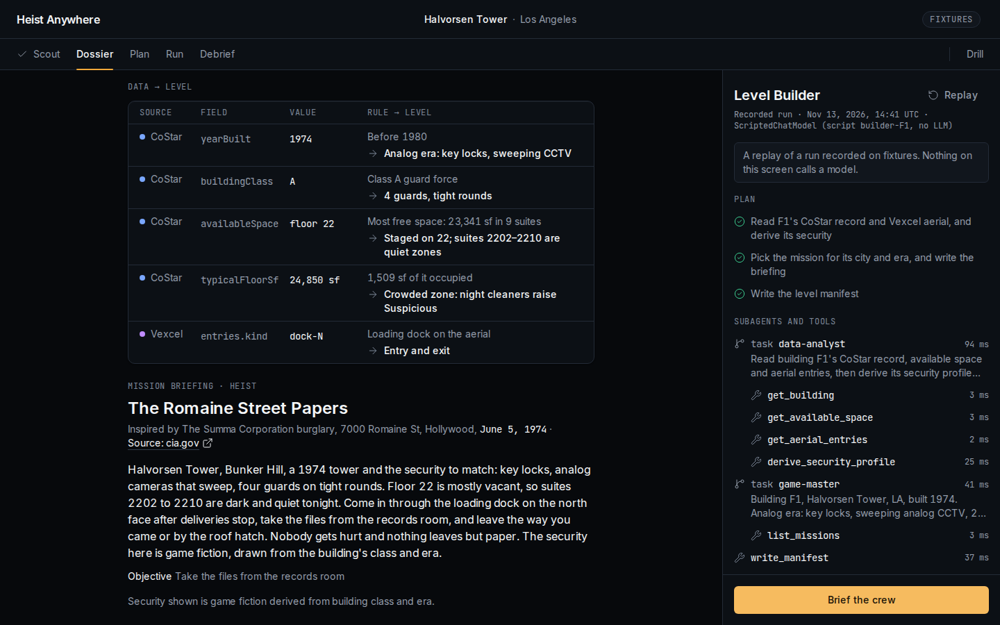
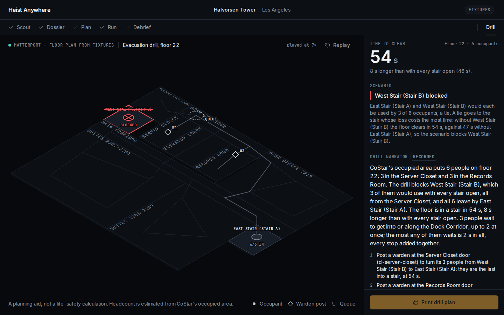
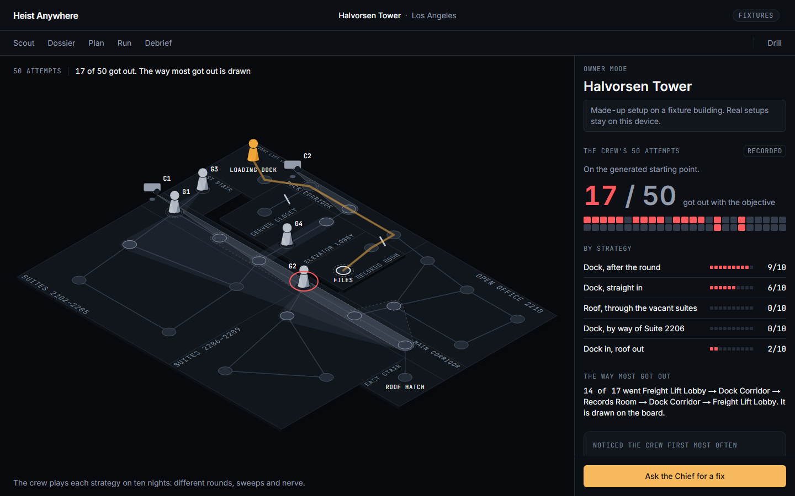
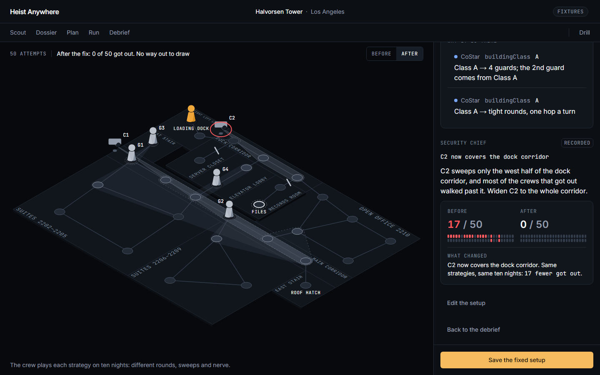
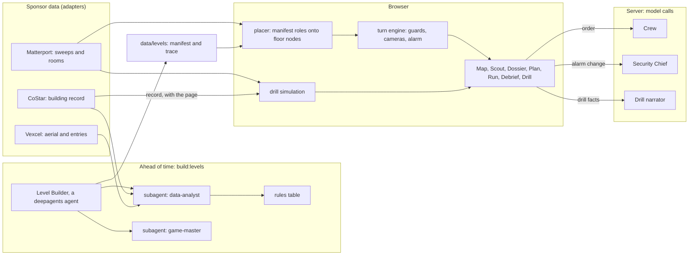

# Heist Anywhere

**A turn-based stealth game whose levels an AI agent builds from a building's
data: CoStar's record sets the security era, the guard force and the quiet
zones, Vexcel's aerial sets the ways in, and Matterport's scan is the board.
Click any guard to see which data put it there. Then the same engine, on the
same floor, runs the fire drill, and Owner Mode lets a building's security
lead put in their own security and watch an AI crew try 50 ways in.**

Built at HackPrinceton Fall 2026. Main track: Entertainment. Special tracks:
CoStar "AI for the Built World", LangChain "Best use of deepagents", Amazon
"Best Practical AI Innovation". For the Amazon track: the Security Chief
re-plans the guards on every alarm change and says why
([`replanChief`](src/agents/chief/chief.ts)); in this repo its answers are
recorded or rule-based, and the engine clamps its orders to legal moves ([`applyChiefOrders`](src/engine/orders.ts)). Amazon Bedrock is
wired in as an alternative model provider
([`bedrock.ts`](src/adapters/llm/bedrock.ts)) but has never been run: there
are no AWS credentials here.


> **Everything in this repo runs with no API keys.** Every screenshot here is
> fake mode: fixture buildings, a hand-authored floor and recorded model
> turns. The live CoStar, Vexcel, Matterport and Anthropic paths are written
> and unit-tested against stubs. **Only Anthropic has been run against the
> real service, and only for the crew, the Security Chief** (29 calls on
> F1; [latency below](#sponsor-technology-and-where-it-lives)) **and the
> Level Builder** (two runs on fixture building F1). CoStar, Vexcel,
> Matterport and Amazon Bedrock have never been run live. The top bar's
> `FIXTURES` chip says so on every screen. [What runs on what](#sponsor-technology-and-where-it-lives).

## The story

Pick a building in Los Angeles. An agent has read it. **1974** means key locks
and analog cameras that sweep. **Class A** means four guards on tight rounds.
**Floor 22** is mostly vacant, so suites 2202 to 2210 are dark and quiet. The
**loading dock** on the aerial is your way in. The mission is inspired by a
real, non-violent break-in: the 1974 Summa Corporation burglary on Romaine
Street.

You brief your crew in plain English ("Go in through the dock, wait for the
2 am round to pass, take the records room") and they push back: camera C2
covers the dock corridor. Walk into its cone anyway and the alarm jumps to
Alert, the guards converge, and the Security Chief re-plans in the side panel,
saying why. Click a guard and the Why card shows the field behind it: "Class A
→ 4 guards; the 4th guard comes from Class A". Press `L` for the **Layer
lens**, which tints every piece and room by the data layer that produced it.

Then the same engine runs on the same floor as an **evacuation drill**:
occupants placed from CoStar's occupied area, one stair blocked as the
scenario, a time to clear, the queue, and where to post wardens.

**Break into any building for fun. Or put in your real security and watch an
AI crew try 50 ways in.** From the Debrief, **Owner Mode** opens the same board
as a setup editor: move guards and draw their rounds, place cameras, set each
door to key, badge or open, and mark staffed desks. The editor starts from the
level's own security, so it is never empty, and names any broken round before
it lets you run. **Run 50 attempts** asks the crew for a handful of strategies
once, then the engine plays each across many seeds in the browser, with no
further model calls. On F1 in fake mode, 17 of 50 attempts get out, 14 of them
the same way, through the dock. The guard or camera that spotted the crew
first most often is ringed on the board. **Ask the Chief for a fix** suggests
one change ("C2 now covers the dock corridor"), and **Apply and rerun** puts
before and after side by side: 17 of 50 to 0 of 50.

**Who it is for.**

- **The player**: someone who wants a story-driven heist set in a real kind of
  building, in a browser tab, in ten minutes.
- **The fire safety director**: LA and Houston fire rules require regular
  high-rise evacuation drills. Drill Mode turns data CoStar already holds
  into a drill scenario with no site visit and no headset. It is a planning aid, not a
  life-safety calculation, and the screen says so.
- **The building's security lead**: Owner Mode does the first pass of a
  physical security review, the "how would someone get to the records room?"
  walk that today takes a consultant and a site visit, on data CoStar already
  holds. The weak spot the crew keeps using is the one to fix first, and the
  Chief's suggested change can be checked by rerunning before anyone moves a
  camera. It is a first pass, not a security assessment, and it doesn't
  replace one.

**Taste rules we hold to.** No tenant data: the CoStar adapter never requests
a tenant field ([`REQUESTED_FIELDS` and
`REQUESTED_SPACE_FIELDS`](src/adapters/costar/mapping.ts)).
Missions are drawn from documented, non-violent corporate history, or are
fiction and say so ([`fixtures/missions.json`](fixtures/missions.json)). The
security on the board is game fiction derived from class and era, never a
claim about a real building. Owner Mode is the one exception, and it is the
owner's own: the public game only ever shows the generated security, an
owner's setup stays in that browser's storage
([`owner-setup-store`](src/components/run/owner-setup-store.ts)), and no
node, coordinate or route of the floor reaches a model: the crew's strategies
are asked for by building id, and the Chief's fix gets the building id and a
summary of counts and element ids
([`/api/chief/fix`](src/app/api/chief/fix/route.ts)). In this demo the editor opens
only on fixture buildings, with "Made-up setup on a fixture building. Real
setups stay on this device." always on screen. A shipped version would unlock
it only for verified owners of the building, which CoStar's ownership records
already make possible.

| | |
|---|---|
|  |  |
| **Dossier.** The Level Builder's run replays as a checklist of todos, subagent tasks and tool calls, and the Data → Level table fills in. | **Scout.** The aerial's tagged ways in, on a massing drawn from the footprint and height. Scout draws the massing in every mode; it shows no aerial photos yet. |
|  |  |
| **Drill.** Same floor, Stair B blocked: time to clear, the queue, warden posts. | **Layer lens.** Every element tinted and lettered C, V or M by its source, with a legend counting each layer. |
|  |  |
| **Owner Mode.** 50 attempts against the setup: the count, each strategy, and the way out the crew used most. | **Before and after.** The Chief's one change, rerun: 17 of 50 to 0 of 50. |

## How it works

One Next.js app. The game engine and the board run in the browser. Server
route handlers hold the keys and talk to CoStar, Vexcel and the model.
Matterport runs only in the browser.



Every model call on the demo path is a single structured call with a 4 s
timeout and a recorded fallback; the Level Builder's agent loop never runs
during the demo.

1. **The rules table decides the numbers.**
   [`deriveSecurityProfile`](src/level/rules.ts) maps fields to level
   parameters deterministically (year built to security era, class to guard
   count, available space to the staged floor and its quiet and crowded
   zones, aerial tags to entries), and every output carries a provenance entry
   naming its layer, field, value and rule. The agent calls it as a tool
   instead of inventing difficulty. Every Why card reads those entries
   ([`src/components/run/why.ts`](src/components/run/why.ts)), and so does
   the **Layer lens** on the Run and Plan boards
   ([`lensElements`](src/components/run/lens.ts),
   [`layer-lens.tsx`](src/components/run/layer-lens.tsx),
   [`tests/smoke/lens.spec.ts`](tests/smoke/lens.spec.ts)): each guard,
   camera, lock, zone and entry takes its layers from that provenance, and
   the room tiles are Matterport, from the floor graph's `source`.
2. **The Level Builder runs ahead.** It writes a manifest and a trace per
   building to [`data/levels/`](data/levels/), so the demo never waits on a
   model. The Dossier replays the trace.
3. **The engine is authoritative.** [`src/engine/`](src/engine/index.ts) is
   pure, seeded TypeScript. Model output (crew plans, Chief orders) is parsed
   against a zod schema and clamped to legal moves
   ([`applyChiefOrders`](src/engine/orders.ts),
   [`validatePlan`](src/level/validate-plan.ts)), and guards move on the
   engine's own decision before any model answers.
4. **The floor graph is built in the browser, and only these fields leave
   it.** The Matterport floor graph is built in the page. Its coordinates,
   sightlines and room shapes are never sent, and neither is the graph as a
   whole. Three routes take a body from the page:
   - [`/api/crew`](src/app/api/crew/route.ts) reads only the building id and
     the order the player typed
     ([`crew-request.ts`](src/components/plan/crew-request.ts)). The server
     reads the zones and the guard roster from its own cached manifest, and
     from the same manifest the security profile's era, camera kind, camera
     count and lock kind ([`crewContext`](src/agents/crew/prompt.ts)): values
     such as `analog`, `analog-sweep`, `2` and `key`, set from CoStar's
     building facts. No camera's position goes with them.
   - [`/api/chief`](src/app/api/chief/route.ts) takes a
     [`ChiefRequest`](src/agents/chief/request.ts) and refuses any field
     outside it: the building id; the alarm transition (turn, from and to,
     and its cause, with a camera, guard or cleaner id such as `C2`); the
     last-known zone; each guard's id, zone and intent; and the zones the
     Chief may name, as id and name. Those zones are the manifest's zones
     and entries, then the floor's other rooms. On the fixture floor, those
     rooms go by their room id and label. On a scanned floor they go as
     `area-1`, `Area 1` and so on, so no scan id or label reaches the Chief
     ([`chiefZones`](src/components/run/chief-request.ts)). The Run screen
     calls the Chief on every alarm transition, on either kind of floor
     ([`run-screen.tsx`](src/components/run/run-screen.tsx)). So on a scanned
     floor the Chief does learn something shaped by the scan: how many
     `area-N` zones there are, and which one each guard and the last
     sighting is in. The prompt adds the mission and security profile from
     the server's manifest.
   - [`/api/drill/narrative`](src/app/api/drill/narrative/route.ts) takes
     `{facts}`, a strict [`DrillFacts`](src/drill/facts.ts), and the
     narrator gives the model all of it as JSON
     ([`narratorMessages`](src/agents/drill/narrator.ts)). The facts are the
     building id, the floor number, the counts and times, whether the floor
     clears, and room labels: the blocked and open stairs, the bottleneck,
     and each occupied room. They also list every warden post's room label,
     door id and number of people. On the fixture floor, door ids are
     hand-written names such as `d-stair-a`, and a way out with no door
     sends `null`. The Drill screen asks the narrator only for the fixture
     floor. On a scanned floor it makes no request
     ([`drill-screen.tsx`](src/components/drill/drill-screen.tsx)): the
     drill still runs and its figures, warden posts and bottleneck still
     show, all computed in the browser, and the narrator slot says it is
     off for a live scan ([`narrative.tsx`](src/components/drill/narrative.tsx)).
     The route itself would accept any facts that fit the schema, including
     a scan's `door:<sweep>:<sweep>` ids, so this guarantee lives in the
     Drill screen, not the route.
5. **Drill Mode reuses the floor.** [`simulateDrill`](src/drill/simulate.ts)
   is a deterministic evacuation on the same graph, with headcount from
   CoStar's occupied area ([`headcountFor`](src/drill/occupancy.ts)).

## Sponsor technology, and where it lives

Every external service sits behind an adapter whose `index.ts` picks live or
fake from the environment and exports one interface. **Fake** means it answers
from files in [`fixtures/`](fixtures/). **Live** means it calls the service,
and it is chosen only when the mode is `live` and the keys are set. When a
live CoStar, Vexcel or Matterport call fails, the fake takes over from then
on and the app flags it. A model call that fails or times out is answered by
a recording, or for the Chief by its template; the drill narrator's
recordings cover only the drills they were recorded for.

**Status in this repo: built against recorded fixtures; live mode needs
keys.** The only live path run against the real service is Anthropic, for
the crew, the Security Chief and the Level Builder (see their rows below). Each live
adapter's request shape is our best guess pending the event toolkit's
documentation, kept in one `mapping.ts` per service, and is unit-tested on a
stubbed `fetch` or SDK.

| technology | what it does in the product | code | fake (what you see today) | live |
|---|---|---|---|---|
| **CoStar** building data | Year built, class, stories, floor area and available suites become the security era, guard force, staged floor, quiet and crowded zones, and the drill headcount | [`src/adapters/costar/`](src/adapters/costar/index.ts): `getCoStar`, `selectCoStar`; [`live.ts`](src/adapters/costar/live.ts) `createLiveCoStar`; [`mapping.ts`](src/adapters/costar/mapping.ts) `toBuilding`, `REQUESTED_FIELDS`. The record is read by [`src/level/rules.ts`](src/level/rules.ts) and [`src/drill/occupancy.ts`](src/drill/occupancy.ts) | Five invented buildings at plausible LA and Houston blocks, [`fixtures/costar/buildings.json`](fixtures/costar/buildings.json) | `COSTAR_MODE=live` with `COSTAR_API_BASE` and `COSTAR_API_KEY`. Not run |
| **Vexcel** aerial imagery | Tagged entries (dock, garage, lobby, roof, service) become the level's ways in and out, and the Scout screen | [`src/adapters/vexcel/`](src/adapters/vexcel/index.ts): `getVexcel`, `selectVexcel`; [`live.ts`](src/adapters/vexcel/live.ts) `createLiveVexcel`; [`mapping.ts`](src/adapters/vexcel/mapping.ts) `toAerial`. Served by [`/api/buildings/[id]/aerial`](src/app/api/buildings/[id]/aerial/route.ts) | A massing drawn as SVG from each building's footprint and height, with hand-placed entry tags, [`fixtures/vexcel/`](fixtures/vexcel/) | `VEXCEL_MODE=live` with `VEXCEL_API_BASE` and `VEXCEL_API_KEY`. The adapter reads the entry tags and passes Vexcel's image URLs through in the aerial response; nothing is stored, and Scout still draws the massing. Not run |
| **Matterport** 3D scans | Sweeps and rooms become the board: nodes, edges, doors and sightlines | [`src/adapters/matterport/`](src/adapters/matterport/index.ts) (browser only): `getMatterport`, `withFixtureFloor`; [`live.ts`](src/adapters/matterport/live.ts) `createLiveMatterport`; [`mapping.ts`](src/adapters/matterport/mapping.ts) `toFloorGraph` from Showcase SDK `Sweep.data` and `Room.data` | A hand-authored floor for the demo building, [`fixtures/floors/F1.json`](fixtures/floors/F1.json). It is fiction: no Matterport content is in the repo | `NEXT_PUBLIC_MATTERPORT_MODE=live` with `NEXT_PUBLIC_MATTERPORT_SDK_KEY`. Not run |
| **LangChain `deepagents`** | The Level Builder: `createDeepAgent` with a todo list, two subagents (`data-analyst`, `game-master`) and six tools (`get_building`, `get_available_space`, `get_aerial_entries`, `derive_security_profile`, `get_mission`, `write_manifest`); it builds one level per building and mission | [`src/agents/builder/builder.ts`](src/agents/builder/builder.ts) `buildLevel`; tools in [`tools.ts`](src/agents/builder/tools.ts); prompts in [`prompts.ts`](src/agents/builder/prompts.ts); trace in [`trace.ts`](src/agents/builder/trace.ts); run by [`scripts/build-levels.mts`](scripts/build-levels.mts) | The real deep agent runs, graph, todos, subagent dispatch and tools included, against the fake adapters. Only the model's turns are replayed, by [`ScriptedChatModel`](src/adapters/llm/scripted.ts) from [`fixtures/llm/scripts/builder-F1-romaine-1974.json`](fixtures/llm/scripts/builder-F1-romaine-1974.json). The output is [`data/levels/F1.romaine-1974.json`](data/levels/F1.romaine-1974.json) and its trace | The same agent on Claude through `@langchain/anthropic`. Run live twice on F1 (fixture data only) with `claude-sonnet-4-6`: 13 and 14 model calls, no failed tool calls, both manifests valid and the same as the scripted one but for the objective room's name and rule and the briefing. `npm run record:builds -- F1` saved the second run, now in [`fixtures/llm/recorded/pre-119/`](fixtures/llm/recorded/pre-119/). That run predates the mission input (#119): its game master calls the removed `list_missions`, and its briefing breaks the rules `write_manifest` now enforces, so **it no longer replays**; a test keeps it as the case the rules catch. Re-record with `npm run record:builds -- F1:romaine-1974` (needs `ANTHROPIC_API_KEY`), which replaces it. The Dossier replays the hand-written script |
| **Anthropic Claude** | The model for every agent: the Level Builder, and one structured call each for the Crew, the Security Chief and the drill narrator | [`src/adapters/llm/`](src/adapters/llm/index.ts): `selectChatModel` in [`select.ts`](src/adapters/llm/select.ts), `createAnthropicModel` in [`anthropic.ts`](src/adapters/llm/anthropic.ts), `structuredCall` in [`structured.ts`](src/adapters/llm/structured.ts). Agents: [`crew`](src/agents/crew/crew.ts) `briefCrew`, [`chief`](src/agents/chief/chief.ts) `replanChief`, [`drill`](src/agents/drill/narrator.ts) `narrateDrill` | Recorded replies: keyword-routed for the Crew ([`fixtures/llm/crew-F1.json`](fixtures/llm/crew-F1.json)), per alarm transition then a deterministic [template](src/agents/chief/template.ts) for the Chief ([`chief-F1.json`](fixtures/llm/chief-F1.json)), per drill for the narrator ([`drill-F1.json`](fixtures/llm/drill-F1.json)). The UI labels each answer recorded or rule-based | `LLM_MODE=live` with `ANTHROPIC_API_KEY`; default model `claude-sonnet-4-6`; on a 4 s timeout or a bad answer the recording answers instead. Run live for the crew and the Chief: 29 calls on F1, with ten timed calls each. Crew median 3565 ms, p90 3747 ms (misses its 3 s median target); Chief median 2977 ms, p90 3303 ms. A cold first call can pass 4 s and fall back. 20 of 20 timed replies fit their schema. The Level Builder ran live on F1 (see the `deepagents` row); the drill narrator has not been run on Claude |
| **Amazon Bedrock** | An alternative model provider | [`src/adapters/llm/bedrock.ts`](src/adapters/llm/bedrock.ts) `createBedrockModel` (`ChatBedrockConverse` from `@langchain/aws`) | Not used | `LLM_PROVIDER=bedrock` and refused unless `BEDROCK_ENABLED=1`. Not run |

## Run it

You need Node 22.12 or later. No keys, no `.env.local`, no database.

```sh
git clone https://github.com/Ollienel777/heist-anywhere.git
cd heist-anywhere
npm ci
npm run dev
```

Open <http://localhost:3000>. With no `.env.local` every service is on
fixtures, and the top bar shows `FIXTURES`. Pick **Halvorsen Tower** and
follow the primary button on each screen: Scout, Dossier, Plan, Run, Debrief,
Drill. Set `PORT` to use another port.

**Live mode**, once you have keys: copy [`.env.example`](.env.example) to
`.env.local`, set `HEIST_MODE=live`, and fill in the keys you have. Each
service goes live on its own; the rest stay on fixtures.

**Other commands.**

| command | does |
|---|---|
| `npm run gate` | what CI runs: install, lint, typecheck, unit tests, a fake-mode production build, and the Playwright smoke that walks all seven demo beats ([`scripts/gate.mjs`](scripts/gate.mjs), [`tests/smoke/demo-path.spec.ts`](tests/smoke/demo-path.spec.ts)) |
| `npm run build:levels -- F1[:romaine-1974]` | runs the Level Builder for a building and mission (by default the building's own) and rewrites its manifest and trace in `data/levels/<building>.<mission>.json` |
| `npm run record:builds -- F1[:romaine-1974]` | runs the Level Builder live (`LLM_MODE=live` and `ANTHROPIC_API_KEY`, with CoStar and Vexcel on fixtures) and saves the model's turns as a replayable script, with the manifest and trace, in `fixtures/llm/recorded/` |
| `npm run demo:reset` | puts `data/levels/` back to the committed levels; the browser clears what it kept of earlier runs on its next load |

## Stack

Next.js 16 (App Router) and React 19, TypeScript in strict mode, Tailwind CSS
4 with CSS-variable tokens, and `lucide-react`. The board, the massing and the
drill view are SVG; the map is a static basemap rendered from OpenStreetMap
data (© OpenStreetMap contributors), so no tile server is involved. zod for
every schema ([`src/domain/`](src/domain/index.ts)). LangChain JS:
`deepagents`, `langchain`, `@langchain/core`, `@langchain/anthropic`,
`@langchain/aws`. Vitest and Playwright. No database: levels are JSON files,
run logs live in `localStorage`.

## What is next

- **Live data.** Run each adapter against the real CoStar, Vexcel and
  Matterport services once keys arrive, and correct each `mapping.ts`.
- **Aerial photos in Scout.** Show Vexcel's images instead of the massing
  once the live adapter returns them.
- **More buildings.** All five fixture buildings appear on the map, but only
  Halvorsen Tower (F1) has a floor and a built level today; the others show
  "Level in prep".
- **The printable drill plan.** The button is on the Drill screen but
  disabled: the printable plan is not built yet.
- **A Chief that learns.** Let the Security Chief read a summary of the
  player's earlier runs and change its posture between them.
- **Owner Mode, finished.** Make night cleaners editable in the setup editor
  (they already play in the 50 attempts), and gate real setups behind
  verified ownership.
- **Rebuild from the UI.** Run the Level Builder live from the Dossier instead
  of ahead of time.

## Licence

[MIT](LICENSE).
